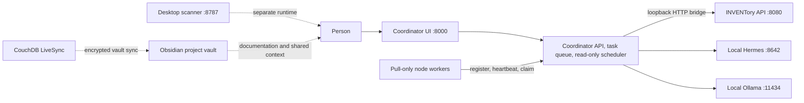

# System map

## Runtime ownership

| Component | Owns | Does not own |
|---|---|---|
| Coordinator | routing, proposals, queue execution, local agent-facing surfaces, bounded read-only status schedule | INVENTory entities or arbitrary access to connected nodes |
| INVENTory | canonical world-model records and their event history | task execution or hardware control |
| Node worker | its local telemetry and explicitly enabled executors | coordinator state or an inbound server |
| Desktop scanner | its own scan/index files | writes into user projects or INVENTory |
| Obsidian vault | human-readable project notes and decisions | runtime state, task queues, credentials, or a replacement database |
| CouchDB | LiveSync transport/storage for the vault | coordinator or INVENTory data |

## Important boundaries

- Coordinator and INVENTory communicate over a constrained localhost HTTP bridge; they do not share a database or import each other's code.
- Runtime databases live outside this vault and must use their configured paths.
- A node initiates outbound polling. Current node behavior is not general remote desktop or file transfer.
- The background schedule only inspects watcher, node-health, queue, and research-source state. It does not create tasks, dispatch nodes, call models, or touch hardware.
- The `/side` experience is frozen by project instructions; it is not edited as part of this effort.

See the repository's `AGENTS.md` and `PROJECTATLAS.md` for the full executable architecture contract.
